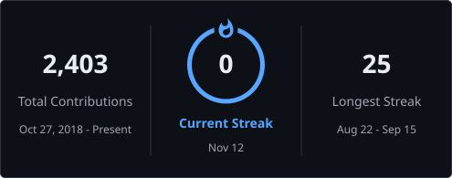

# Mridha Imran Kabir

```http
GET /engineer HTTP/1.1
Host: github.com/imrankabir02
```

```json
{
  "name": "Mridha Imran Kabir",
  "role": "Backend Engineer",
  "runtime": ["Django", "FastAPI", "Laravel"],
  "data": "PostgreSQL — Row-Level Security · PostGIS · TimescaleDB",
  "location": "Khulna, Bangladesh (GMT+6)",
  "employment": {
    "main": "IT Engineer @ BIFPCL",
    "side_contract": "Lead Backend Engineer @ CloudHub (concluding Nov 2026)"
  },
  "status": "open_to_full_time_remote_roles",
  "shipping_since": "January 2024",
  "systems_shipped": 19
}
```

> Most profiles are a wall of badges. This one is a system — because that's what I build.
> Send a request, watch where it goes.

---

## The architecture

Every system I ship runs through the same path. It also happens to be my skill set:

```text
  client
    │
    ▼
  nginx ──────────────► django · fastapi · laravel ──────────────► postgresql
    │                          │                                    ├─ row-level security
    │                          ├──► celery workers (redis broker)   ├─ postgis
    │                          │      idempotent · per-row errors   └─ timescaledb
    │                          └──► transactional outbox
    │                                 (notifications survive outages)
    ▼
  docker on linux · CI/CD at every hop · monitoring so it tells you when it breaks
```

What I actually do at each hop: design the schema, write the API, make the slow query fast,
make the background job survive bad input, and stay the person who answers when it breaks.

---

## Routing table — experience

| Route | Service | Response |
|---|---|---|
| `2025-06 → now` | **BIFPCL** — IT Engineer *(main role)* | Sole author of a large internal Django platform: 80+ models, multi-module monolith, migrated SQLite → MSSQL in place and kept shipping on top of it |
| `2026-07 → 2026-11` | **CloudHub** — Lead Backend Engineer *(contract)* | Lead backend author on a multi-tenant B2B SaaS: tenant isolation enforced by the database itself, transactional outbox, TimescaleDB ingestion |
| `2025-01 → 2025-06` | **Barikoi Maps** — Software Engineer | Location-intelligence backends in Laravel: geofence containment and nearby-point queries that stayed fast as the dataset grew |
| `2024-01 → 2025-01` | **Phone Tech BD** — Backend Developer | First professional role; two Laravel apps built from scratch — Shifttrek is still in production |

## Service registry — selected systems

| System | Status | The hard part | Proof |
|---|---|---|---|
| **CloudHR** — multi-tenant B2B SaaS | 🟢 in production | A missed `WHERE` clause must fail closed, not leak another tenant's data | PostgreSQL RLS + transactional outbox |
| **BIFPCL Operations Platform** | 🟢 in production | One author, 80+ models, requirements that never stop arriving | In-place SQLite → MSSQL migration |
| **Bangladesh Electricity Demand Dataset** | 🟢 published | Public PDFs, no API — rebuilt as tidy data that validates itself | 2,469 days · [DOI 10.5281/zenodo.21783853](https://doi.org/10.5281/zenodo.21783853) |
| **Reliable Background Import System** | 🟢 tested | One bad row must never abort the whole import | 54 tests / 189 assertions |
| **Legal Document Intelligence** | 🟢 tested | Generated text that can't cite its source is worthless | Hybrid BM25 + vector retrieval · 57 tests |
| **Gatepass** — approval workflow engine | 🟢 in production | No approval may land half-applied | Finite state machine · atomic transitions |

The full registry — all 19 systems, each with the problem, the decision and the tradeoff —
lives on my portfolio: **[imrankabir02.github.io](https://imrankabir02.github.io/)**

## Public proof — the strongest repositories

The systems above are production work, so most of their code is private. These public
repositories are where the same skills can be inspected:

| Repository | What it proves | The evidence |
|---|---|---|
| **[ReliableBackgroundImportSystem](https://github.com/imrankabir02/ReliableBackgroundImportSystem)** | Import architecture, redesigned end to end | Problem analysis → new schema → concurrency & idempotency design, as a 23 KB engineering write-up · Laravel · Docker · 54 tests / 189 assertions |
| **[chess-timer](https://github.com/imrankabir02/chess-timer)** | Algorithms and test discipline | A full chess engine — perft-verified move generation, SAN parsing, a deterministic seeded bot that tests can assert on · Kotlin · 18 test files · Android CI |
| **[EngineeringAtlas](https://github.com/imrankabir02/EngineeringAtlas)** | Engineering judgment, written down | A 129-topic competency graph whose levels and prerequisites are data, enforced by schema — plus docs on philosophy, levels and technology selection · Python · Mermaid |
| **[task-manager](https://github.com/imrankabir02/task-manager)** | Full-stack delivery | Django REST API + TypeScript frontend, live demo, complete setup documentation |
| **[mess-system](https://github.com/imrankabir02/mess-system)** | Multi-user product engineering | Invitations, roles and authorization for shared living costs · Laravel · documented database design · Docker |

Across 31 public repositories, the most code is PHP/Laravel and Python, then Kotlin and
TypeScript — the same stack as the production systems above.

## Behind the login wall

Most of my serious work lives in private repositories — 49 of them. The code stays closed,
but the problems and the patterns are what I bring to a team:

| The problem that lands on my desk | How I build for it |
|---|---|
| Tenants must never see each other's data | Isolation enforced by PostgreSQL itself (RLS) — the database fails closed, not the application code |
| Field teams, customers, billing and payroll in one system | Modular FastAPI platform — TimescaleDB ingestion for GPS/geofence tracking, queued jobs, encrypted sensitive fields, append-only audit records |
| A shop's internet dies mid-sale | Offline-first point of sale — local state machines for stock and sales, sync with conflict handling when the connection returns (NestJS monorepo, end-to-end tested) |
| Health records shared between organisations | Consent — purpose, scope, expiry — enforced at the data-access layer, every read audit-logged, standards-based clinical data model, hundreds of tests |
| Buses, drivers and passengers coordinating live | Trip lifecycle as a state machine — idempotent start, auto-expiry — with live GPS, freshness labels, and access rules the database enforces |
| Personal data that must survive any device | Offline-first Flutter apps — local storage, append-only ledgers, optional sync to a self-hosted Django server |

Same habits everywhere: the database enforces the rule, the job survives bad input, and the
audit trail is append-only.

---

## On-call notes

- Slow queries made fast. Jobs that survive bad input. Systems that tell you when they break.
- Idempotent jobs, per-row error isolation, indexes chosen for the real query.
- Tenant isolation enforced by the database itself — a missed filter fails closed, it doesn't leak.
- I own what I ship: schema → migration → deploy → the Linux box it runs on.

## The stack

**Runtime**<br/>


**Data**<br/>


**Infra & tooling**<br/>


<p>

</p>

<p>

</p>

<picture>
  <source media="(prefers-color-scheme: dark)" srcset="https://raw.githubusercontent.com/imrankabir02/imrankabir02/output/github-contribution-grid-snake-dark.svg"/>
  <source media="(prefers-color-scheme: light)" srcset="https://raw.githubusercontent.com/imrankabir02/imrankabir02/output/github-contribution-grid-snake.svg"/>
  
</picture>

## Education

- **B.Sc in Computer Science & Engineering** — Khulna University, Khulna · 2018 — 2024
- **HSC in Science** — Digraj Degree College, Mongla, Bagerhat · 2014 — 2016

---

```http
HTTP/1.1 200 OK
Content-Type: text/plain; charset=utf-8
```

You reached the end of the request path — thanks for tracing it.
If you're hiring for a full-time remote backend role (Django / FastAPI + PostgreSQL),
this is the part where we talk:

**[imrankabir325@gmail.com](mailto:imrankabir325@gmail.com)** · **[Portfolio](https://imrankabir02.github.io/)** · Khulna, Bangladesh

<sub>Response time: usually within a day, GMT+6.</sub>


