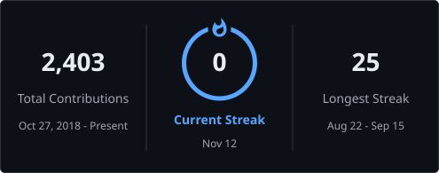

  

  Backend engineer from <b>Khulna, Bangladesh</b>. I design APIs and data layers that stay calm under load — 
  multi-tenant SaaS, offline-first sync, and databases that enforce their own rules. 
  🏢 IT Engineer @ <b>BIFPCL</b> &nbsp;·&nbsp; Lead Backend Engineer (contract) @ <b>CloudHub</b>

  
  
  

---

<h2 align="center">📌 Featured projects</h2>

  
  

📊 <a href="https://doi.org/10.5281/zenodo.21783853"><b>Bangladesh Electricity Demand Dataset</b></a> — 2,469 days of national load data, DOI-archived
 
🏭 <a href="https://imrankabir02.github.io/"><b>Production systems — CloudHR, the BIFPCL platform &amp; more</b></a> — presented on my portfolio (the code is private)

---

<h2 align="center">🛠️ Tech stack</h2>

<b>Runtime</b>

  

<b>Frameworks</b>

  

<b>Data &amp; infrastructure</b>

  

---

<h2 align="center">📊 GitHub at a glance</h2>

  
  

  

  <picture>
    <source media="(prefers-color-scheme: dark)" srcset="https://raw.githubusercontent.com/imrankabir02/imrankabir02/output/github-contribution-grid-snake-dark.svg"/>
    
  </picture>

---

 
<b>📈 Full GitHub metrics</b>
   
  
 
 

<b>🏭 Production work — the short version</b>

 

- **Multi-tenant SaaS** for ISP operations — tenant isolation enforced by PostgreSQL row-level security; TimescaleDB GPS/geofence ingestion; encrypted fields; append-only audit
- **Power-plant operations platform** — BIFPCL (main role, since June 2025)
- **Offline-first POS** — local state machines, conflict-handled sync, end-to-end browser tests
- **Health records** — patient consent enforced at the data-access layer; every read audit-logged; hundreds of tests
- **Fleet coordination** — trip-lifecycle state machine, live GPS with freshness labels, database-enforced access rules

<b>🗓️ Milestones</b>

 

- 🚀 **2026** — Published the *Bangladesh Electricity Demand Dataset* — 2,469 days of national load data, DOI-archived ([10.5281/zenodo.21783853](https://doi.org/10.5281/zenodo.21783853))
- 🏭 **2026** — Lead Backend Engineer (contract) @ CloudHub — multi-tenant platform running in production
- ⚡ **2025** — IT Engineer @ BIFPCL — operations platform for a national power plant
- ♟️ **2025** — A complete chess engine in Kotlin — perft-verified move generation, 18 test files
- 🌱 **2024** — Started professional backend work — **19 systems shipped** since

<b>🎓 Education</b>

 

- **B.Sc in Computer Science & Engineering** — Khulna University (2018 – 2024)
- **HSC, Science** — Digraj Degree College, Mongla (2014 – 2016)

---

  

  📍 Khulna, Bangladesh (GMT+6) &nbsp;·&nbsp; <a href="https://imrankabir02.github.io/">Portfolio</a> &nbsp;·&nbsp; <a href="mailto:imrankabir325@gmail.com">imrankabir325@gmail.com</a>

  

